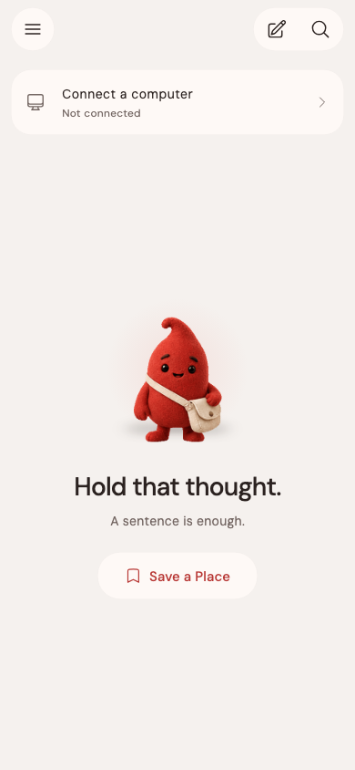
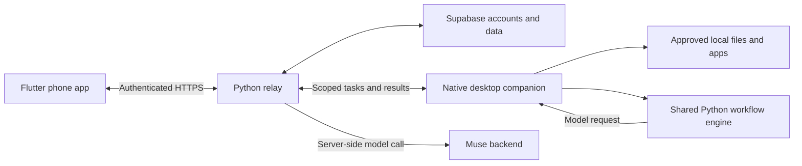

<p align="center">
  
</p>
<h1 align="center">Pico</h1>
<p align="center">A companion for the work you leave on your computer—and pick up from your phone.</p>
<p align="center">
  <a href="https://pico-companion.fly.dev/setup#setup">Download</a> ·
  <a href="#getting-started">Getting started</a> ·
  <a href="#architecture">Architecture</a> ·
  <a href="docs/runbook.md">Build guide</a> ·
  <a href="https://github.com/adityadev54/pico/issues">Report an issue</a>
</p>
<p align="center">
  <a href="https://github.com/adityadev54/pico/actions/workflows/windows.yml"></a>
</p>

## Why Pico?

Moving between a phone and a computer usually means losing context: the file you need is on the other device, a half-finished task slips away, or a useful routine has to be repeated from scratch.

Pico connects those moments. A small desktop character holds your place while the phone provides a conversation for finding files, reviewing actions and running routines you have taught it. The desktop stays an overlay and background helper, not another dashboard.

<p align="center"></p>
<p align="center"><sub>Phone UI rendered from the application’s widget tests.</sub></p>

## A workflow, not another chat tab

For example, prepare a weekly study review:

1. Give Pico access to a folder containing your lecture notes.
2. Choose **Teach a routine…**, select the notes and edit an example of the review you want.
3. Approve learning that example with Muse.
4. Next week, update the inputs and run the saved routine from your phone.
5. Pico reads the current files, checks the response’s source quotations, and saves a new result on your computer.

This is selected-file teaching. It does not record arbitrary clicks or keystrokes, and it does not automate every desktop app. [Read the workflow guide →](docs/watch-and-repeat.md)

## What is built

| Capability | What it does |
| --- | --- |
| Places | Save a next step, park unfinished work and pick it up on the computer |
| Computer actions | Open approved apps/sites; search approved folders; read or transfer a selected file |
| Reviewed file tools | Create/edit files, save phone uploads, copy unique photos, convert supported documents, manage PDFs and ZIPs, and trash/restore files |
| Watch & repeat | Learn a demonstrated document transformation and repeat it on changed or replacement inputs |
| Phone input | Text plus microphone and camera actions in the composer |
| Companions | Original animated characters with activity-driven moods and synchronized state |

Deterministic tools, Places and moods do not require a model call. Taught routines and supported AI requests use Muse through the authenticated backend. Connected actions still require the relay; “local tool” does not mean the whole product works offline.

## Getting started

Download the phone app and desktop companion from the [setup page](https://pico-companion.fly.dev/setup#setup).

| Platform | Distribution |
| --- | --- |
| Android 7+ | APK |
| iPhone | Safari web app → Add to Home Screen |
| Apple silicon Mac, macOS 13+ | DMG |
| Windows 10/11 x64 | Self-contained EXE |

Sign in on the phone, create a six-digit pairing code and enter it on the computer. Then choose the apps and folders Pico may access. Start with an ordinary request such as **“Find my lecture notes.”**

On Windows, **Open apps → Choose app…** lists apps by name, including running apps and registered Store apps. Search for Calculator, Chrome, Word or the application you actually want Pico to open; you should not have to identify a folder under Program Files. Manual `.exe` selection remains available for apps that are not discovered.

## Architecture



- **Flutter** owns the phone conversation, review cards, account state and companion presentation.
- **Swift/AppKit and C#/WinForms** own desktop overlays, native controls and platform integration.
- **Python** provides the relay, scoped tools, teaching engine and output validation. Windows bundles this runtime; users do not install Python.
- **Supabase** supplies account and service data. Privileged credentials stay server-side.

The desktop decides what it is permitted to execute. A model response is a proposal, not permission to bypass a folder grant, approval or conflict check.

## Development

Prerequisites: Flutter with the relevant platform SDK, Python 3.12+, and .NET 10 for the native Windows companion. Mac builds require Xcode command-line tools.

```sh
git clone https://github.com/adityadev54/pico.git
cd pico
flutter pub get
python3 -m venv .venv-runtime
.venv-runtime/bin/python -m pip install -r requirements-document-tools.txt

# Phone app: uses the configured relay by default.
sh scripts/run_phone.sh

# Mac companion.
sh scripts/run_companion.sh
```

On Windows use `py -3 -m venv .venv-runtime` and `.venv-runtime\Scripts\python.exe`. To build the native companion:

```sh
python scripts/build_windows_installer.py
```

This downloads the bundled runtime and builds `downloads/Pico-Setup.exe`. See the [build and release guide](docs/runbook.md) for signed Android builds, Mac packaging and the iPhone web app.

### Running your own relay

Configure an existing compatible Supabase backend; this repository does not provision its database policies. Put `SUPABASE_URL` and `SUPABASE_SERVICE_ROLE_KEY` in an ignored server environment file. Muse additionally needs server-only `MUSE_API_URL`, `MUSE_API_KEY`, `MUSE_MODEL` and the required account/budget configuration.

```sh
PICO_ENV_FILE=/path/to/server.env sh scripts/run_relay.sh
sh scripts/run_phone.sh --dart-define=RELAY_URL=http://localhost:8765
sh scripts/run_companion.sh --relay http://localhost:8765
```

Use your computer’s reachable address for physical-phone development; `localhost` on a phone refers to that phone. Non-local plain HTTP is disabled by default in the helper. Keep public Flutter configuration separate from service credentials. [Security notes →](docs/security.md)

### Tests

```sh
flutter analyze
flutter test
.venv-runtime/bin/python -m unittest discover -s agents/tests
.venv-runtime/bin/python -m unittest discover -s test -p '*test.py'
.venv-runtime/bin/python -m unittest discover -s relay/tests
.venv-runtime/bin/python -m unittest discover -s server/tests
dotnet run --project test/windows_core/WindowsCore.csproj
```

Windows CI exercises the shared worker, permissions, app grants, file operations, pairing and installer build on a Windows runner. UI/device checks are still needed for camera behavior and monitor-specific rendering.

### Repository layout

```text
lib/            Flutter components, screens, services, models and theme
agents/         Desktop helpers, native UI and shared workflow engine
relay/          Authenticated transport, mailbox and budget integration
server/         AI planning and verification
scripts/        Run, build and packaging commands
config/         Public application configuration
website/        Download and setup page
test/           Flutter/integration tests and native Windows checks
docs/           Workflow, security and release guides
```

Generated builds, downloads, environments, private reports and pairing state are ignored. Do not commit signing material or service credentials.

## Boundaries worth knowing

- This is a development release: the Mac download is development-signed rather than notarized, and no native iPhone IPA is published.
- File transfers and supported conversion outputs currently have a 1 MB cap. Taught routines use 1–4 readable documents, at most 6,000 characters total, and an example up to 2,000 characters. Scanned PDFs need OCR elsewhere; Word-to-PDF needs LibreOffice.
- Windows window previews are opt-in, remain local, and exclude browsers and sensitive apps. They are not uploaded to Muse.
- New moods are automatic motion on the original GIFs, not five newly drawn facial animations. [Mood behavior →](docs/companion-moods.md)
- Muse access and spending limits are server-controlled. A reservation is not a provider invoice. Model requests are not automatically retried.

## Contributing

Keep changes focused and include the relevant regression checks. For a bug, report the phone/desktop versions, operating system, steps, expected result and actual result. Redact tokens and private file contents from logs or screenshots.

Before submitting changes, run the checks above and update the relevant guide if behavior changes. Permission changes must preserve revocation, approval and changed-file checks. Please discuss broad changes in an [issue](https://github.com/adityadev54/pico/issues) first.
