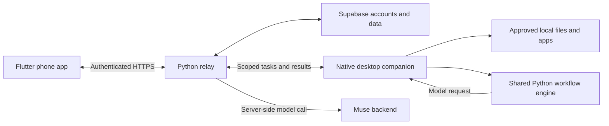

<p align="center">
  
</p>
<h1 align="center">Pico</h1>
<p align="center">Pick up your work across your phone and computer.</p>
<p align="center">
  <a href="https://pico-companion.fly.dev/setup#setup">Download</a> ·
  <a href="docs/development.md">Developer guide</a> ·
  <a href="https://github.com/adityadev54/pico/issues">Issues</a>
</p>
<p align="center">
  <a href="https://github.com/adityadev54/pico/actions/workflows/windows.yml"></a>
</p>

Pico pairs a phone conversation with a small desktop companion. Save your next step, work with approved files and apps, or teach a document routine once and repeat it on fresh inputs.

## What it does

- **Hold your place:** save and park unfinished work, then return to it on your computer.
- **Reach your computer:** find files, transfer a selected document, and open approved apps or websites.
- **Watch & repeat:** show Pico an example result, then run the learned routine from your phone.
- **Stay in control:** explicit folder permissions, reviewed changes and source-checked AI output.

File tools and companion moods do not need a model call. Taught routines use Muse through the authenticated backend. Connected actions require the relay.

## Get started

Install Pico on your [phone and computer](https://pico-companion.fly.dev/setup#setup), sign in on the phone, and enter its six-digit pairing code on the computer. Choose the apps and folders Pico may access, then try **“Find my lecture notes.”**

**Platforms:** Android APK · iPhone Safari web app · Apple silicon Mac, macOS 13+ · Windows 10/11 x64.

## Architecture



Built with Flutter, native Swift/C# desktop controls, a shared Python workflow engine and Supabase. The desktop enforces permissions; model output cannot bypass them. Service credentials stay server-side.

## Develop

```sh
git clone https://github.com/adityadev54/pico.git
cd pico
flutter pub get
sh scripts/run_phone.sh
```

Requires Flutter and the target platform SDK. Desktop development also uses Python 3.12+; Windows builds use .NET 10. See the [developer guide](docs/development.md) for companion setup, a local relay, tests and repository layout.

## Documentation

- [Teach and repeat a routine](docs/watch-and-repeat.md)
- [Build and release](docs/runbook.md)
- [Security and permissions](docs/security.md)
- [Companion moods](docs/companion-moods.md)
- [Current limits](docs/development.md#current-limits) · [Release notes](RELEASE-NOTES.md)

## Contribute

Keep changes focused, run the relevant checks, and include reproduction steps for bugs. Never commit credentials or private file contents. Discuss broader changes in an [issue](https://github.com/adityadev54/pico/issues) first.
