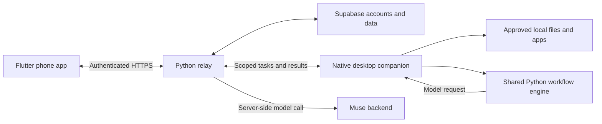

<p align="center">
  
</p>
<h1 align="center">Pico</h1>
<p align="center">Pick up your work across your phone and computer.</p>
<p align="center">
  <a href="https://pico-companion.fly.dev/setup#setup">Download</a> ·
  <a href="docs/development.md">Developer guide</a> ·
  <a href="https://github.com/adityadev54/pico/issues">Issues</a>
</p>
<p align="center">
  <a href="https://github.com/adityadev54/pico/actions/workflows/windows.yml"></a>
</p>

Pico pairs a phone conversation with a small desktop companion. Save your next step, work with approved files and apps, or teach a document routine once and repeat it on fresh inputs.

## Demo

[Watch the public Pico demo](https://pico-companion.fly.dev/demo.html)

[Download the original video](docs/media/pico-demo.mp4).

## What it does

- **Focus gate:** choose “I’m focused” from the companion menu; results wait in Places until “I’m done.” App-opening and reviewed actions wait too.
- **Hold your place:** save and park unfinished work, then return to it on your computer.
- **Reach your computer:** find and inspect files, transfer a selected document, and open approved apps or websites.
- **Work with files:** create or revise files, convert supported formats, merge/split/rotate/watermark PDFs, and create or extract ZIP archives. Reviewed trash and restore require the appropriate folder access.
- **Capture from your phone:** use the composer’s + menu for microphone input or a camera photo; approved photos save to your computer’s write folder.
- **Watch & repeat:** show Pico an example result, then run the learned routine from your phone.
- **Stay in control:** explicit folder permissions, reviewed changes and source-checked AI output.

## Where Muse works

Muse runs on the authenticated server, not inside the phone or desktop app:

| Flow | Muse’s role |
| --- | --- |
| Watch & repeat | Learns a recipe from selected documents and your example; applies it to new inputs with source-quote checks. |
| AI computer request | `Ask Pico: …` plans one supported action or asks for clarification. Local permissions and review still apply. |
| Summarize with Muse | Summarizes the selected, already-read document excerpt—not the entire computer. |

Basic file/app commands, transfers, parking, camera capture and companion moods do not call Muse. Voice input uses the platform speech service. Step-away previews do not currently generate Muse guesses. Connected actions still need the relay; Muse requests additionally need account access and available budget. Failed model calls are not automatically retried.

## Get started

Install Pico on your [phone and computer](https://pico-companion.fly.dev/setup#setup), sign in on the phone, and enter its six-digit pairing code on the computer. Choose the apps and folders Pico may access, then try **“Find my lecture notes.”**

**Platforms:** Android APK · iPhone Safari web app · Apple silicon Mac, macOS 13+ · Windows 10/11 x64.

## File actions

Conversions run locally on your computer, without Muse:

| Input | Output |
| --- | --- |
| Images | PDF, PNG, JPEG or WebP |
| Text-based PDF | TXT or DOCX (text only; layout is not preserved) |
| DOCX | PDF; requires LibreOffice installed on the computer |

Use an approved **write folder**, keep the companion connected, then ask naturally—for example, **“Convert lecture.docx to PDF.”** Review the action when prompted. Results save beside the source; conversion preserves originals and uses a numbered filename if the output already exists.

Conversion inputs and outputs are limited to **1 MB**. PDF operations support up to **100 pages**; scanned PDFs need OCR, which is not included. For setup, more examples and dependencies, see [file actions](docs/file-actions.md).

## Architecture



Built with Flutter, native Swift/C# desktop controls, a shared Python workflow engine and Supabase. The desktop enforces permissions; model output cannot bypass them. Service credentials stay server-side.

## Develop

```sh
git clone https://github.com/adityadev54/pico.git
cd pico
flutter pub get
sh scripts/run_phone.sh
```

Requires Flutter and the target platform SDK. Desktop development also uses Python 3.12+; Windows builds use .NET 10. See the [developer guide](docs/development.md) for companion setup, a local relay, tests and repository layout.

## Documentation

- [File actions and requirements](docs/file-actions.md)
- [Teach and repeat a routine](docs/watch-and-repeat.md)
- [Build and release](docs/runbook.md)
- [Security and permissions](docs/security.md)
- [Companion moods](docs/companion-moods.md)
- [Current limits](docs/development.md#current-limits) · [Release notes](RELEASE-NOTES.md)

## Contribute

Keep changes focused, run the relevant checks, and include reproduction steps for bugs. Never commit credentials or private file contents. Discuss broader changes in an [issue](https://github.com/adityadev54/pico/issues) first.
